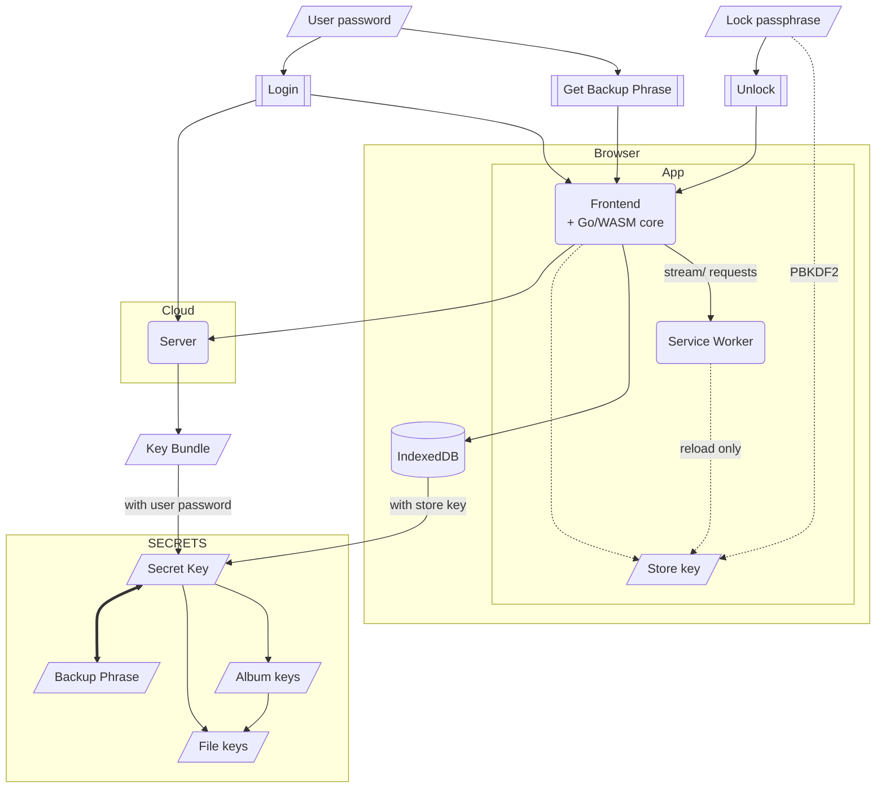
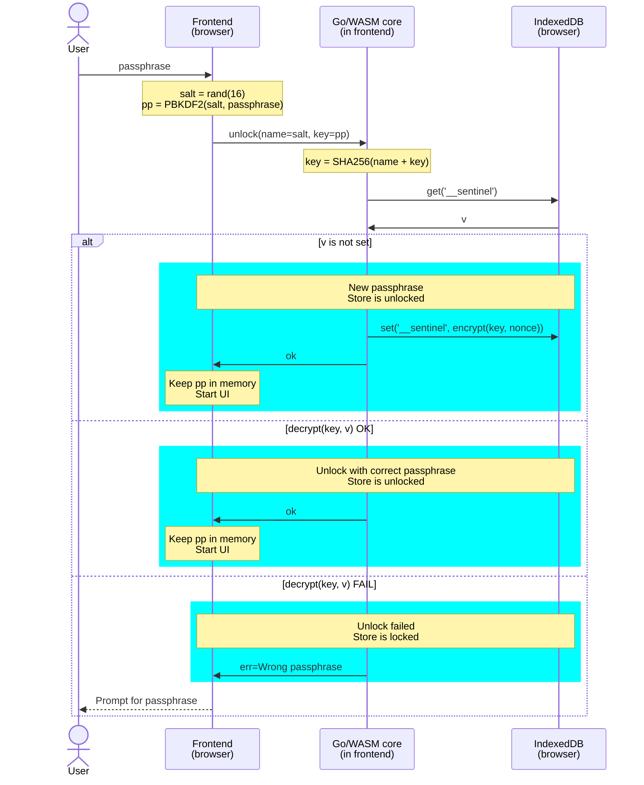
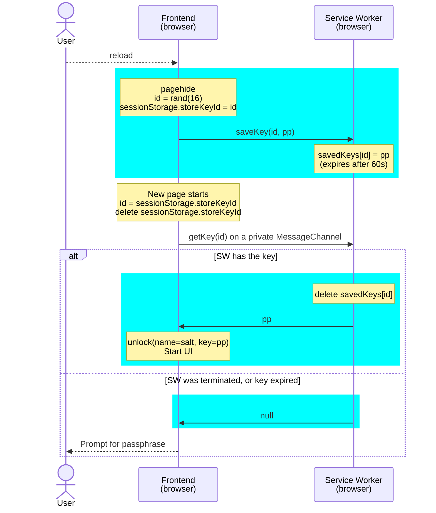
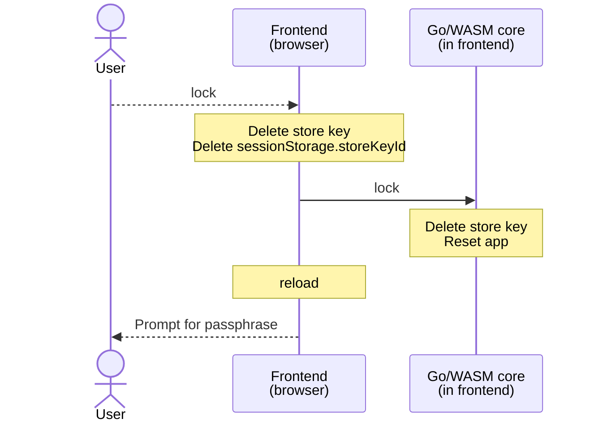
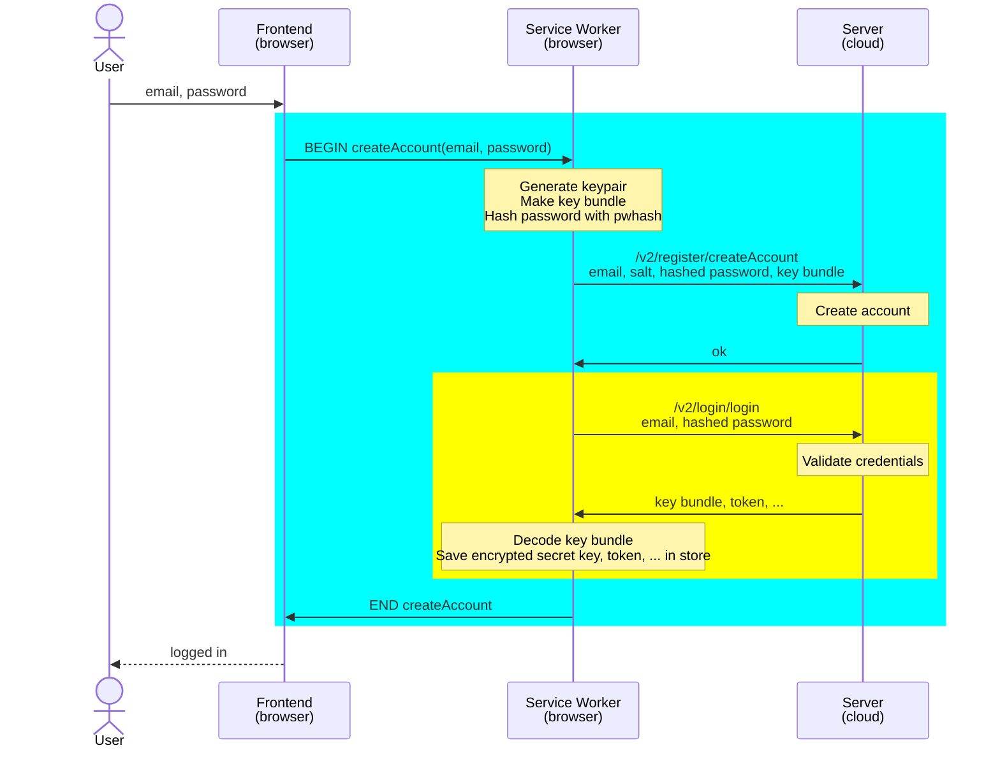
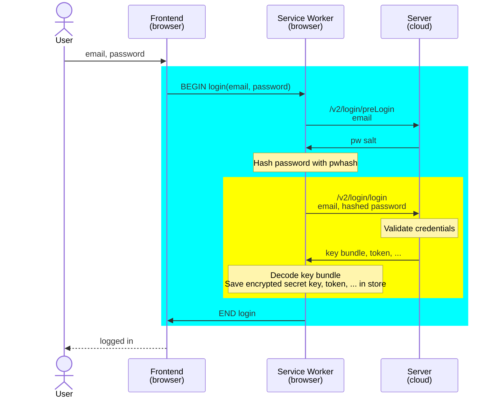
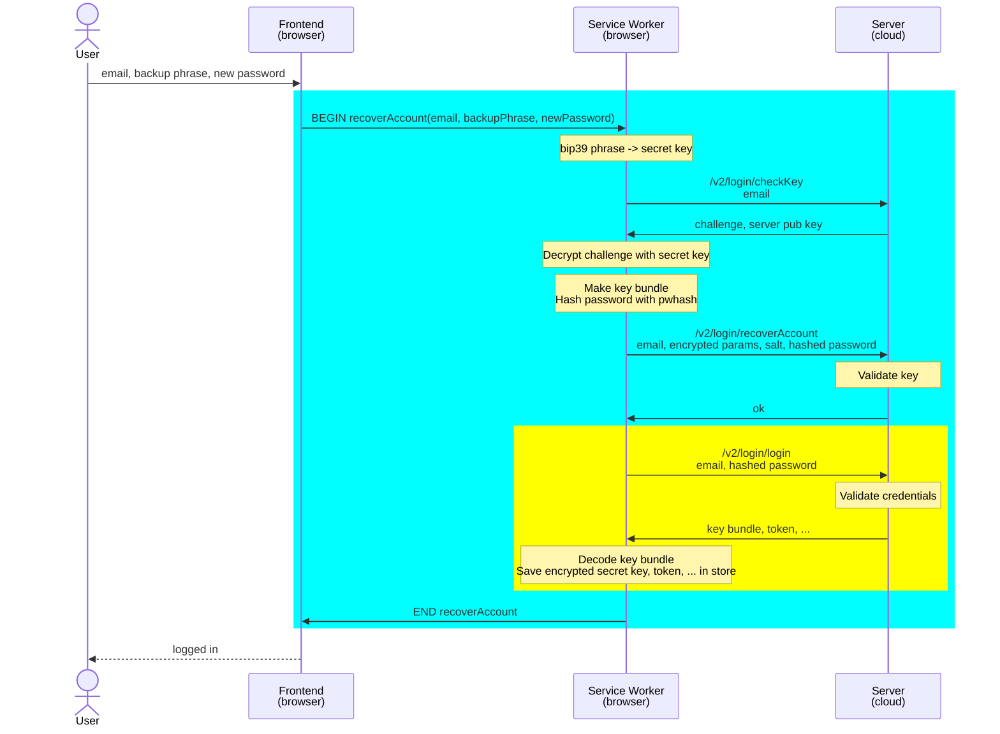
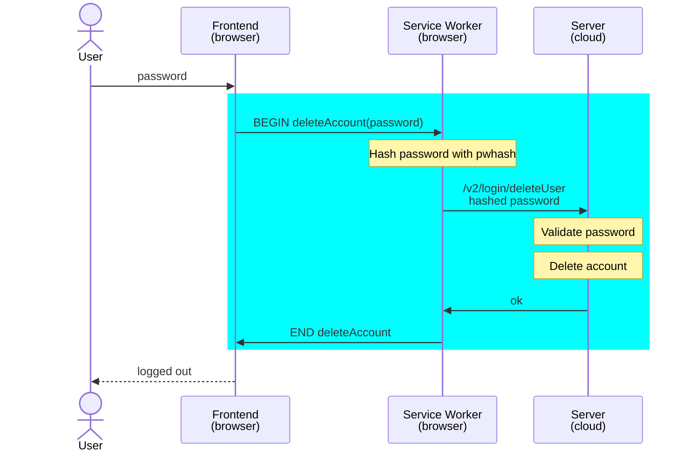
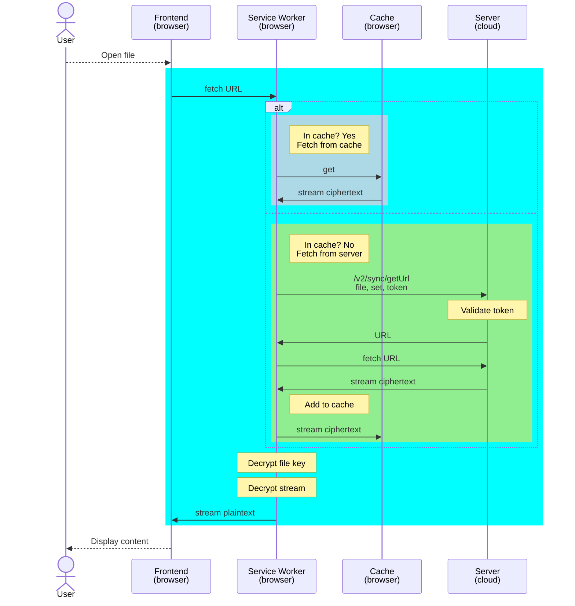
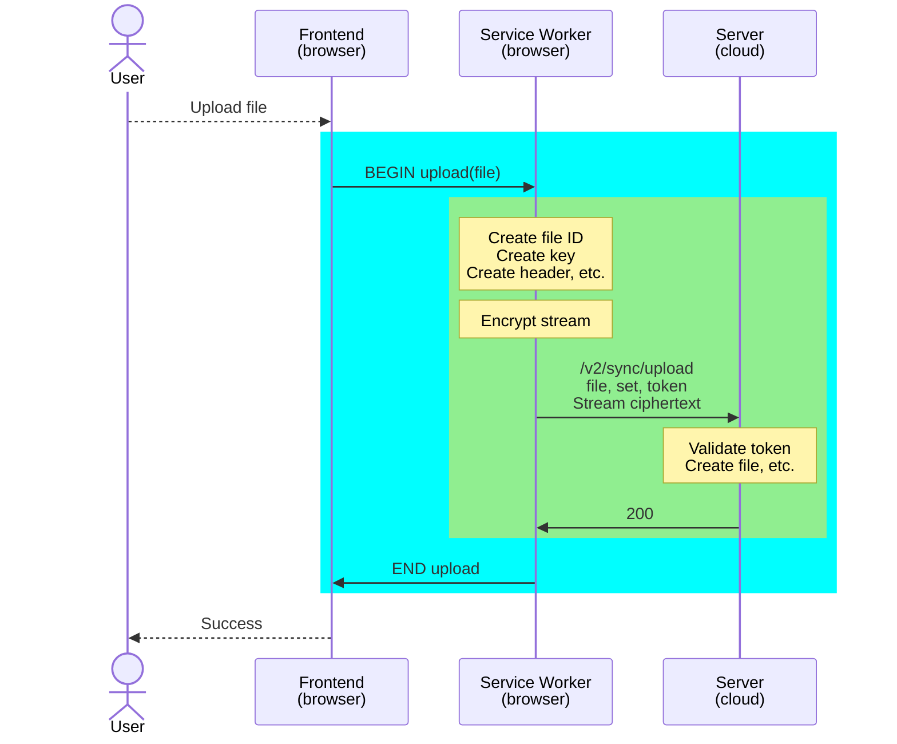

# PWA

## Secret key

The `secret key` is the root of trust of a user. It is used to encrypt file keys, album keys, and some request parameters. It can also be used to recover the user's account and force a new password. It is very important to protect it.

Within the PWA, the `secret key` is saved in the encrypted store, which is protected by the `store key`. When the app is _locked_, the `store key` is not present into the PWA anywhere. When the app is _unlocked_, the `lock passphrase` is used to derive the `store key`. The frontend (and the Go/WASM core running in it) keeps the `store key` in memory only, as long as the app is _unlocked_. It is never written to `localStorage`, `sessionStorage`, or IndexedDB. Across a page reload, it is handed to the service worker for a few seconds (see [Reload frontend](#reload-frontend)). There is no API to retrieve the `store key` from the frontend or the service worker, but forensics tools could get it. Knowledge of the `lock passphrase` or the `store key`, combined with the `salt` used to derive the `store key` are sufficient to discover the user's `secret key`.

The user's `password` can also be used to retrieve the `secret key` from the `key bundle` that's stored on the server. The `key bundle` (usually) contains an _encrypted_ version of the `secret key`, and the user's `password` can be used to decrypt it. So, knowledge of the user's `password` is sufficient to discover the user's `secret key`.

The user's `backup phrase` is effectively the same thing about the user's `secret key`, presented in a human-readable format.

## Encrypted store sequence diagrams

The PWA uses an encrypted object store in IndexedDB. The object keys are plaintext, but the values are encrypted with `crypto_secretbox` using a 256-bit key derived from a passphrase provided by the user, or a random key if the user chooses the _skip passphrase_ option.

The store is opened and used by the Go/WASM core, which runs in the frontend (the page). The frontend keeps the `store key` in memory only. The service worker does not use the store. It serves the app's static files, and forwards `stream/` media requests to the frontend for decryption.

Because the frontend reloads when switching between apps, or when the user triggers a page reload, the `store key` would normally be lost on every reload. To avoid prompting the user each time, the frontend hands the `store key` to the service worker right before it unloads, indexed by a random one-time `id` that is saved in `sessionStorage`. The new page retrieves the key with that `id`. The service worker keeps the key in memory only, drops it as soon as it is retrieved, or after 60 seconds, or when the browser terminates the service worker. The key itself is never written to web storage.

When the service worker is not running when the page comes back (e.g. the browser was restarted), or when the store was manually locked, the user has to enter the passphrase.

This section describes the sequence of events for setting a passphrase, locking, unlocking, etc.

Note that the server is not involved at all.

### Set passphrase / unlock

Sequence diagram of setting a passphrase or unlocking the store. This sequence also happens when the frontend is reloaded and the `store key` could not be retrieved from the service worker.

### Reload frontend

Sequence diagram of reloading the frontend while the store is unlocked.

### Lock

Sequence diagram for locking the store.

## Account lifecycle

When a user creates an account, they provide their `email`, a `salt`, a `hashed password`, and a `key bundle`. The `key bundle` contains the user's public key, and usually the user's encrypted secret key.

When the user logs in, they provide their `email`, and their `hashed password`. After the credentials are validated, the server returns a `token` and the user's `key bundle`. The `token` is evidence that the user is logged in and must be included in most requests.

If the user forgets their password, they can use their `backup phrase` to recover their account. The `backup phrase` is a `bip39` mnemonic of the secret key itself, i.e. it is functionally equivalent to the secret key.

### Create account

### Login

### Recover account

### Delete account

## Media

Media files are encrypted with a symmetric key. Each file has its own key, which is itself kept encrypted using the either the user's `secret key` or the `album secret key`.

When media files are download, the encrypted blob is retrieved from the server and decrypted by the service worker. Similarly, when a file is uploaded, it is encrypted by the service worker, and then the encrypted blob is uploaded to the server.

### Read / download media

### Upload media

